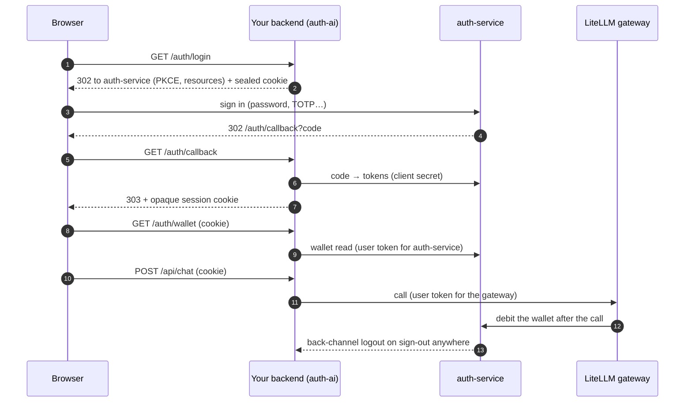

<p align="center">
  <picture>
    <source media="(prefers-color-scheme: dark)" srcset="docs-site/public/logo-dark.svg">
    
  </picture>
</p>

<h1 align="center">CIRCLE auth-ai</h1>

<p align="center">
  <em>The TypeScript SDK for CIRCLE auth-service — sign-in, entitlements, billing and LLM credit, in one library.</em>
</p>

<p align="center">
  <a href="https://github.com/circle-rd/auth-ai/actions/workflows/ci.yml"></a>
  <a href="https://www.npmjs.com/package/@circle-rd/auth-ai"></a>
  <a href="LICENSE"></a>
  <a href="https://nodejs.org"></a>
  <a href="https://www.typescriptlang.org"></a>
  <a href="https://github.com/circle-rd/auth-service"></a>
</p>

Let your application sign users in with a self-hosted
[CIRCLE auth-service](https://github.com/circle-rd/auth-service), read what they
are entitled to (roles, permissions, plan features), meter what they consume,
and call LLMs on their behalf through a [LiteLLM](https://docs.litellm.ai)
gateway that bills their credit wallet — without writing any OAuth, token
refresh, logout or billing plumbing yourself.

Full documentation: **https://docs.circle-cyber.com/auth-ai/**

```ts
const handlers = await createAuthHandlers({
  auth,
  grants,
  sessions,
  secret,
  ai,
});
await app.register(authPlugin, { handlers }); // /auth/login, /callback, /me, /logout…

app.get("/api/models", { preHandler: requireAuth(handlers) }, async (request) =>
  ai.forUser(request.authSession!.userId).gateway.listModels(),
);
```

## Principles

- **Do not reinvent OAuth.** Protocol work stays with the maintained libraries
  [`openid-client`](https://github.com/panva/openid-client) and
  [`jose`](https://github.com/panva/jose); the SDK adds what is specific to
  auth-service on top of them.
- **Backend-for-frontend by default.** The browser holds one opaque session
  cookie. Access and refresh tokens never reach it.
- **Fail loud, leak nothing.** Invalid state is rejected, not repaired. Errors
  carry stable codes; HTTP responses expose the code and a generic message, and
  the detail stays in your logs.
- **Strict at every boundary.** Every external payload (tokens, API answers,
  cookies, environment) is validated with [Zod](https://zod.dev); `any` is
  banned.
- **One package, hard boundaries.** Browser entry points import no server code
  (a test enforces it); frameworks are optional peer dependencies.
- **Centralized spending.** The SDK never debits a wallet itself: the gateway
  bills each call, so margin and pricing stay under the administrator's control.

## Features

**Sign-in and sessions**

- Authorization-code flow with PKCE, `state` and `nonce`, multi-audience
  tokens ([RFC 8707](https://www.rfc-editor.org/rfc/rfc8707)), TOTP handled by
  the provider.
- One serialized refresh-token chain per user, with per-audience access tokens
  minted on demand and never stored.
- Sealed one-shot login cookie, hashed session ids, `__Host-` cookies,
  same-origin redirect targets, refused cross-site logout.
- Claims (roles, permissions, features, plan, organization) renewed from the
  provider on a schedule.
- **Back-channel logout**: signature, `typ`, audience, event, lifetime and
  replay checks, then the sessions and grant of the user end.

**Entitlements**

- Typed claims and helpers: `hasRole`, `hasPermission` (write implies read),
  `hasFeature`, `getFeature`.
- Bearer-token verification for your own API, with RFC 9728
  protected-resource metadata and `WWW-Authenticate` challenges (MCP-friendly).

**LLM gateway and credit wallet**

- One switch in auth-service ("LiteLLM support") and one option here
  (`gatewayUrl`) turn on the gateway and wallet audiences.
- An origin-locked `fetch` that signs OpenAI-compatible calls with a fresh user
  token; model listing; MCP endpoint URLs; gateway errors mapped
  (`402` → `GW_001`, `429` with `Retry-After`, …).
- Wallet reads: balance, spend statistics, per-session usage, transactions,
  top-up link. Amounts are exact `bigint` micro-euros.

**Billing and consumption**

- Machine client (`client_credentials`, cached and single-flighted): a user's
  subscription, metered usage and invoices; usage reporting with idempotency
  keys for features billed per call.

**Frontend**

- Framework-agnostic browser client and observable stores, React hooks
  (`useAuth`, `useUser`, `useEntitlements`, `useWallet`, `useModels`…) and Vue
  composables.

**Delivery**

- Web-standard `Request` → `Response` handlers (mount them anywhere) and a
  Fastify plugin.
- ESM, Node 22+, full type declarations, MIT licensed.

## Install

```sh
pnpm add @circle-rd/auth-ai
# optional peers, as you need them
pnpm add fastify react vue
```

Register your application in auth-service first: a confidential application with
the **LiteLLM support** switch on (if you call the gateway), the redirect URI
`https://<host>/auth/callback` and the back-channel logout URI
`https://<host>/auth/backchannel-logout`.

## Quick start

A Fastify backend (the stores below live in memory: demo only, see
[Production](#production)):

```ts
import Fastify from "fastify";
import {
  GrantManager,
  MemoryGrantStore,
  createAiClient,
  createAuthClient,
} from "@circle-rd/auth-ai";
import { authPlugin, requireAuth } from "@circle-rd/auth-ai/fastify";
import { MemorySessionStore, createAuthHandlers } from "@circle-rd/auth-ai/web";

const auth = createAuthClient({
  issuer: "https://auth.example.com",
  clientId: "my-app",
  clientSecret: process.env.AUTH_CLIENT_SECRET,
  redirectUri: "https://app.example.com/auth/callback",
  gatewayUrl: "https://llm.example.com",
});
const grants = new GrantManager({ auth, store: new MemoryGrantStore() });
const ai = createAiClient({ auth, grants });

const handlers = await createAuthHandlers({
  auth,
  grants,
  ai, // adds /auth/wallet, /auth/wallet/stats and /auth/models for your frontend
  sessions: new MemorySessionStore(),
  secret: process.env.COOKIE_SECRET!, // 32+ random characters
});

const app = Fastify();
await app.register(authPlugin, { handlers });

app.get("/api/models", { preHandler: requireAuth(handlers) }, async (request) =>
  ai.forUser(request.authSession!.userId).gateway.listModels(),
);
await app.listen({ port: 3000 });
```

A React frontend:

```tsx
import { AuthProvider, useAuth, useWallet } from "@circle-rd/auth-ai/react";

function Header() {
  const { status, user, login, logout } = useAuth();
  const { data: wallet } = useWallet({ pollIntervalMs: 15_000 });
  if (status !== "authenticated")
    return <button onClick={() => login()}>Sign in</button>;
  return (
    <p>
      {user?.name} · canSpend={String(wallet?.canSpend)}{" "}
      <button onClick={() => void logout()}>Sign out</button>
    </p>
  );
}

root.render(
  <AuthProvider>
    <Header />
  </AuthProvider>,
);
```

Calling the gateway with any OpenAI-compatible SDK:

```ts
const { gateway } = ai.forUser(userId);
const client = new OpenAI({
  baseURL: gateway.openAiBaseUrl,
  apiKey: "unused", // replaced by a fresh user token on every request
  fetch: gateway.fetch,
});
```

A complete, deployable application lives in [`examples/minimal`](examples/minimal).

## Entry points

| Import                       | Runs in             | What it gives you                                                                  |
| ---------------------------- | ------------------- | ---------------------------------------------------------------------------------- |
| `@circle-rd/auth-ai`         | Node, edge, browser | OIDC client, grants, claims helpers, wallet and gateway clients, error registry    |
| `@circle-rd/auth-ai/server`  | Node, edge          | Bearer verification, back-channel logout, protected-resource metadata, machine API |
| `@circle-rd/auth-ai/web`     | Node, edge          | Sign-in handlers (`Request` → `Response`), session store contract                  |
| `@circle-rd/auth-ai/fastify` | Node                | Fastify plugin and `requireAuth` / `loadSession` hooks (`fastify` ≥ 5.12.6)        |
| `@circle-rd/auth-ai/client`  | Browser             | Cookie-only browser client and observable stores                                   |
| `@circle-rd/auth-ai/react`   | Browser             | `AuthProvider` and hooks (`react` ≥ 18)                                            |
| `@circle-rd/auth-ai/vue`     | Browser             | `createAuthPlugin` and composables (`vue` ≥ 3.4)                                   |

## Architecture



```
auth-ai/
├── 📁 src/
│   ├── client.ts          AuthClient — discovery, PKCE login, refresh, logout, revoke, introspect
│   ├── config.ts          Zod-validated configuration (gatewayUrl adds the gateway audiences)
│   ├── grants.ts          GrantManager — serialized refresh rotation, per-audience tokens
│   ├── claims.ts          Claim schemas and entitlement helpers
│   ├── wallet.ts          WalletClient and wallet schemas (bigint micro-euros)
│   ├── gateway.ts         GatewayClient — origin-locked fetch, listings, MCP URLs
│   ├── ai.ts              createAiClient().forUser(grantId)
│   ├── errors.ts          AuthAiError + ERR registry (OIDC_*, TOK_*, GW_*, SES_*…)
│   ├── 📁 server/         Bearer verifier, back-channel logout, machine API
│   ├── 📁 web/            Sign-in handlers, sealed cookies, session store contract
│   ├── 📁 fastify/        Fastify adapter
│   ├── 📁 browser/        Cookie-only client and stores (entry point `/client`)
│   ├── 📁 react/          React bindings
│   └── 📁 vue/            Vue bindings
├── 📁 examples/minimal/   Deployable end-to-end app with a self-test
└── 📁 docs-site/          Docus documentation (built into a container image)
```

## Production

The SDK is storage-agnostic on purpose. Before going live:

- **Persist sessions and grants.** Implement `SessionStore` and `GrantStore` on
  your database. The in-memory stores sign everyone out on restart and cannot
  be shared by replicas.
- **Several replicas?** Provide a distributed `GrantLock` (a refresh token
  rotates on every use; a replayed one revokes the whole family) and a shared
  `ReplayStore` for back-channel logout tokens.
- **Secrets from the environment only:** the client secret and a 32+ character
  cookie secret. Neither is ever logged or returned.
- **Registered URIs must match:** `redirectUri` is `<origin><basePath>/callback`
  and the back-channel URI is `<origin><basePath>/backchannel-logout`, reachable
  over HTTPS by auth-service.
- **Log with `onError`, answer with `toPublicJSON()`.** Never forward
  `error.message` or `error.details` to a browser.
- **Keep `fastify` ≥ 5.12.6** (several 2026 advisories are fixed there).

## Documentation

The full documentation is published at
[docs.circle-cyber.com/auth-ai](https://docs.circle-cyber.com/auth-ai/):
concepts, one guide per framework, the configuration and API reference, the
error-code registry and a production checklist.

**For AI agents** — the documentation is exposed through a built-in MCP server
(HTTP), so agents can query it directly:

| Environment | MCP endpoint                                                    |
| ----------- | --------------------------------------------------------------- |
| Production  | `https://docs.circle-cyber.com/auth-ai/mcp`                     |
| Local dev   | `http://localhost:3000/mcp` (run `npm run dev` in `docs-site/`) |

**Contributing** — the development rules in [AGENTS.md](AGENTS.md) (naming,
TypeScript strictness, error handling, testing, security) and the process in
[CONTRIBUTING.md](CONTRIBUTING.md) are mandatory for any contribution.
Security reports: see [SECURITY.md](SECURITY.md). Releases are tracked in
[CHANGELOG.md](CHANGELOG.md).

## Roadmap

- **Python port** of the same behaviours (the test suite pins them), for the
  Python backends of the CIRCLE stack.
- **Migration of [gine](https://github.com/circle-rd/gine)** onto the SDK.
- **npm Trusted Publishing** once the first release is out, replacing the
  publish token.
- **More adapters** on top of the Web-standard handlers, as needs appear.

## Credits & license

Built and maintained by [CIRCLE](https://circle-cyber.com). Stands on the
shoulders of [openid-client](https://github.com/panva/openid-client),
[jose](https://github.com/panva/jose), [Zod](https://zod.dev) and
[Fastify](https://fastify.dev).

Licensed under the **MIT License** — see [LICENSE](LICENSE).
